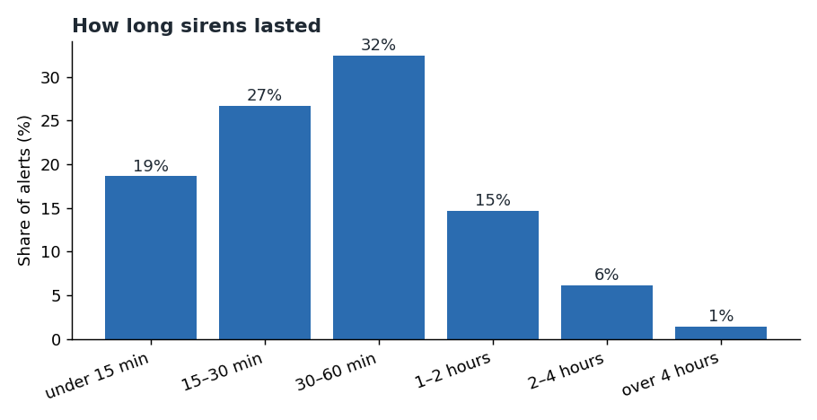
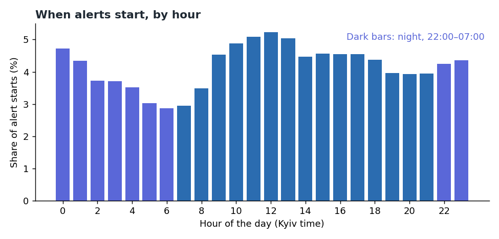
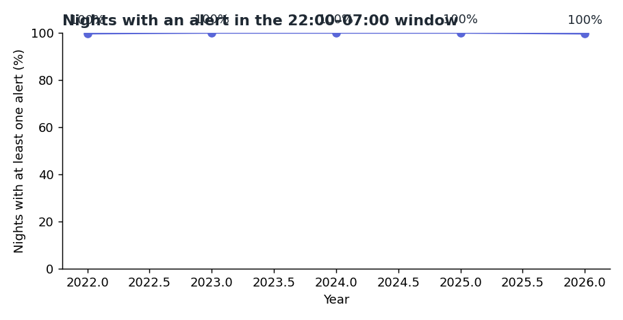
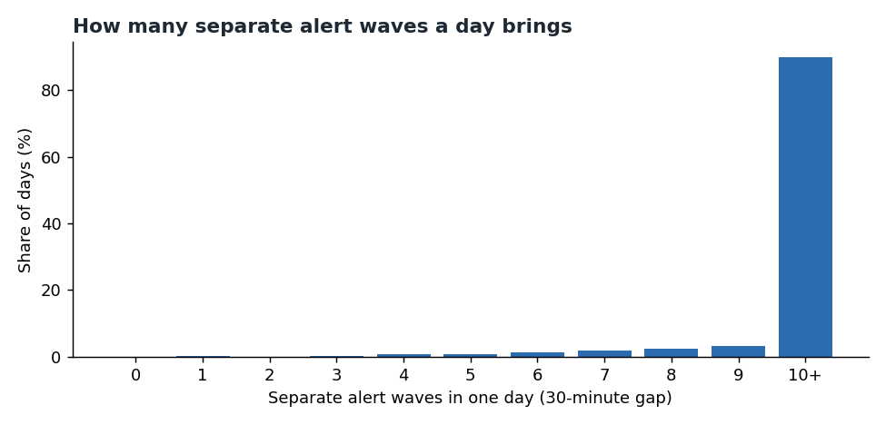

# Chapter 1: When sirens sound, and how long they last

*How long alerts last, when they start, and what that means for sleep and daily routines.*

Everything in this chapter comes from the volunteer alert record, from 25 February 2022 to 11
October 2026. It counts **what was recorded**, not what happened. The record has no launch times,
no impact times and no threat types, so it cannot tell you how much warning anyone had or what
caused an alert. Read it as a picture of the rhythm of alerts, not a measure of danger.

Reproduce every number and chart with `python -m scripts.chapter01_timing`.

---

## The short version

- **A typical alert lasts about half an hour.** Half of all alerts end within 30 minutes of starting.
- **Most of the rest are short too, but about 1 in 13 alerts runs for more than two hours.**
- **Alerts come in clusters, and they come often.** On a typical day there are 14 separate alert
  waves across the country.
- **Night is not quiet.** Almost every night since 2022 has had at least one alert somewhere in
  Ukraine.

---

## 1. How long alerts last

| How long | Share of alerts |
|---|---:|
| Under 15 minutes | 19% |
| 15 to 30 minutes | 27% |
| 30 to 60 minutes | 32% |
| 1 to 2 hours | 15% |
| 2 to 4 hours | 6% |
| Over 4 hours | 1% |

- **Median:** 30 minutes. **90% of alerts end within about 104 minutes.**
- **Under 30 minutes:** 45% of alerts.
- **Over an hour:** 22% of alerts.
- **Over three hours:** 3% of alerts.

**What this means in practice.** A 30-minute wait is the usual case. Plan for an hour or more for
about one alert in five. Plan for longer waits for the few that run past two hours (about 1 in 13).

**Caveat.** About 5% of end times in the record were inferred, not recorded. Leaving them out
moves the median from 30.0 to 31.1 minutes and the share over an hour from 22% to 23%. The
difference is small, but it is in the direction of longer alerts.

---

## 2. When alerts start

Alerts start at every hour, but not evenly. The busiest hours are late morning and early afternoon
(about 10:00 to 13:00, Kyiv time). The quietest is about 06:00.

**Night** here means 22:00 to 07:00. Night holds **34%** of alert starts. If alerts were spread
evenly across the day, night would hold 29%, because it covers 7 of 24 hours. So night is slightly
over-represented, not avoided. A night alert is no rarer than a daytime one, and it is more likely
than an even spread would suggest.

---

## 3. Nights

Across the country, **99.9% of nights** since February 2022 had at least one alert start between
22:00 and 07:00. In every full year the share was at least 99.7%.

**Read this carefully.** This counts whether *any* oblast had an alert in the night window. It does
not mean that every resident was woken on every night. A single alert in a distant oblast counts
the same as one over a whole region. A per-region view of night alerts is planned for a later
chapter, with the same caveats.

---

## 4. How many alerts in a day

The record groups alerts into **waves**: runs of alerts in which each one starts within 30 minutes
of the previous one (see [the glossary](../GLOSSARY.md)).

- **Typical day:** 14 separate waves (median). **Busy days:** 18 or more waves (1 day in 10).
- **Almost no day is quiet.** Only 0.1% of days had fewer than three waves.
- **Quiet gaps are short.** The median gap between one wave and the next is **38 minutes**. One gap
  in ten is 8 minutes or less.

**What this means in practice.** The main effect on daily life is not one long alert. It is the
repeated pattern of stopping, waiting and restarting. People who plan a commute, a lesson or a
shift face many short pauses, and the gap between them is often too short to settle back in.

---

## What this chapter cannot tell you

- **How much warning anyone had.** There are no launch or impact times in the record.
- **Whether a given alert was for a missile, a drone or an aircraft.** The record does not say.
- **What any one person experienced.** The figures count oblast alerts across the country.
- **Whether the record is complete.** It is a volunteer record with no ground truth to check it
  against.

For warnings and shelter guidance, use official channels of the Air Force and the civil-protection
authorities.

---

## Method

- **Data:** the volunteer alert record, 115,989 rows after removing exact duplicates.
- **Durations:** end time minus start time, in minutes. Rows with zero or negative duration are
  excluded (6 rows).
- **Local time:** Kyiv time, for hours and nights.
- **Nights:** a night starts at 22:00 on one date and ends at 07:00 the next. It counts as touched
  if any oblast starts an alert inside that window.
- **Waves:** a 30-minute gap rule on the start times across all oblasts (see
  `scripts/alert_waves.py`).
- **Script:** `scripts/chapter01_timing.py`. Its numbers are saved to `output/analysis/`
  (gitignored).
