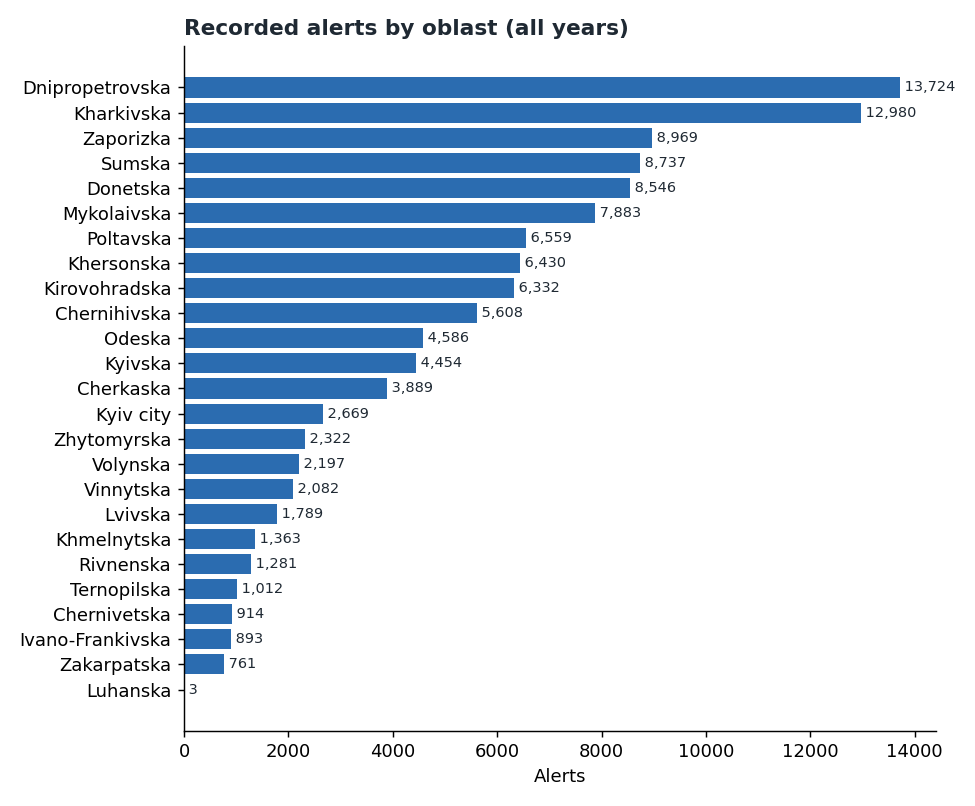
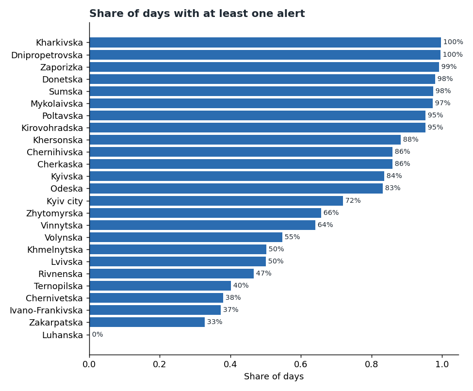
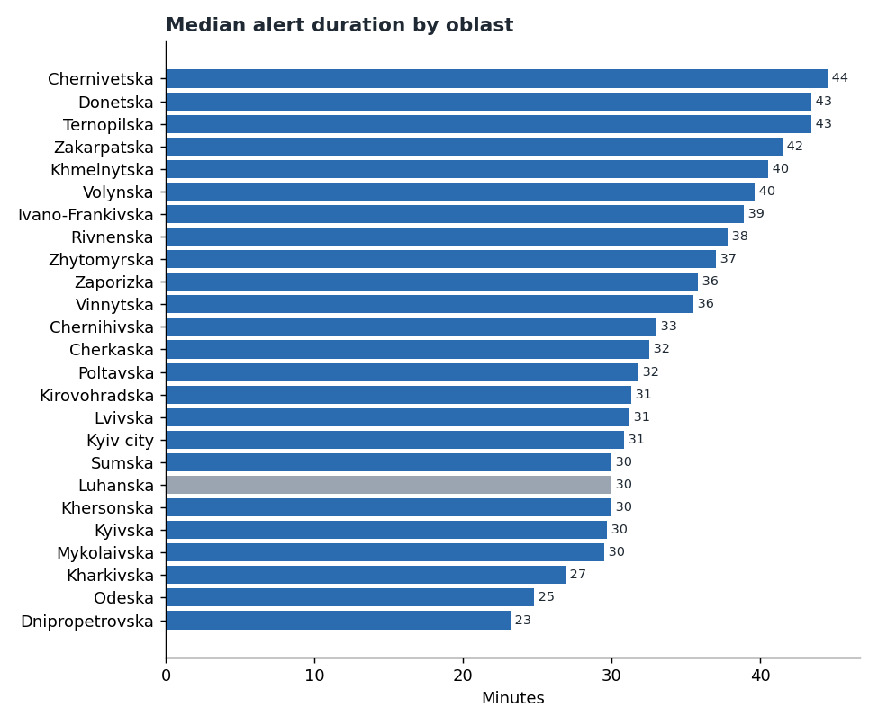
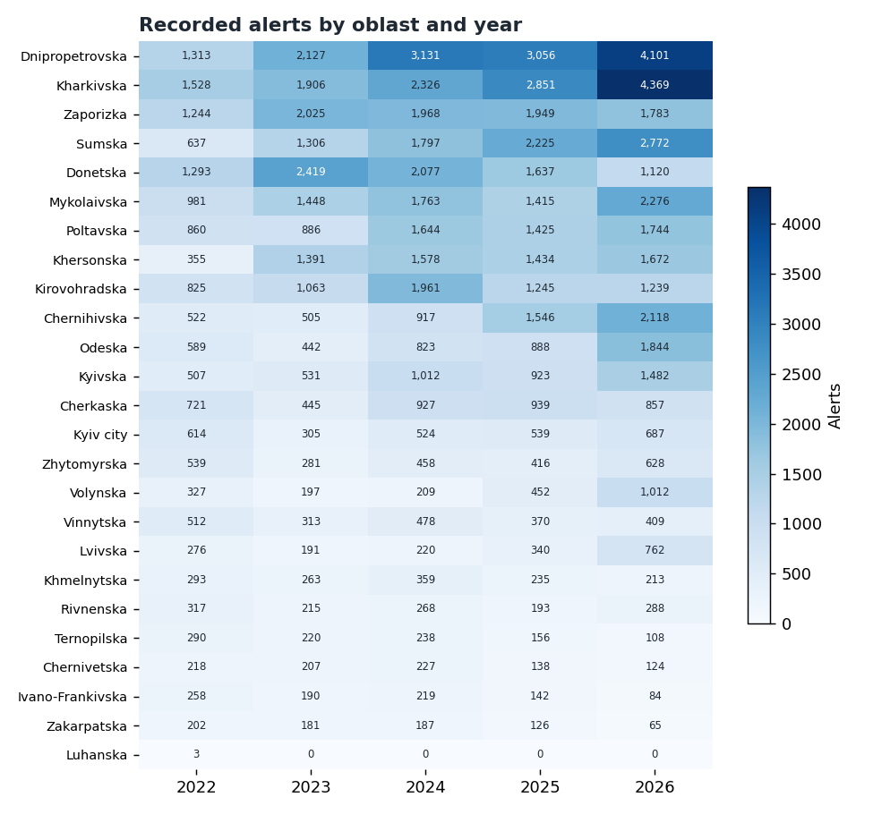

# Chapter 2: Where sirens sound

*How often alerts occur in each oblast, how long they last there, and how the pattern has moved
over time.*

Source: the volunteer alert record, 25 February 2022 to 11 October 2026. Reproduce everything with
`python -m scripts.chapter02_regions`.

Read this chapter with the limits in mind. Counts describe **recorded alerts in each oblast**. They
do not describe how many people were affected, how strong any threat was, or where anything was
aimed. Oblasts also differ in size and population, and the record has no population data, so
these figures are not per person.

---

## The short version

- **Two oblasts account for nearly a quarter (23%) of all recorded alerts.** Dnipropetrovska (12%) and Kharkivska
  (11%) lead. The top ten oblasts hold about three-quarters (74%) of all alerts.
- **Busy and long are not the same thing.** Dnipropetrovska has the most alerts, but a typical one
  lasts 23 minutes. Donetska has fewer alerts, but 40% of them last over an hour.
- **In 2026 the recorded rate rose in most oblasts.** Some rose by more than 150% against 2025 per
  day. This may reflect the reporting, not only the events, so read the change with care.
- **Some oblasts have far fewer recorded alerts.** Zakarpatska and Ivano-Frankivska had one on about
  a third of days (33% and 37%).

---

## 1. Alerts by oblast

| Oblast | Alerts | Share of all alerts |
|---|---:|---:|
| Dnipropetrovska | 13,724 | 11.8% |
| Kharkivska | 12,980 | 11.2% |
| Zaporizka | 8,969 | 7.7% |
| Sumska | 8,737 | 7.5% |
| Donetska | 8,546 | 7.4% |
| Mykolaivska | 7,883 | 6.8% |
| Poltavska | 6,559 | 5.7% |
| Khersonska | 6,430 | 5.5% |
| Kirovohradska | 6,332 | 5.5% |
| Chernihivska | 5,608 | 4.8% |

The full table for all 25 regions (24 oblasts and Kyiv city) is in `output/analysis/chapter02_region_table.csv`
(gitignored). The top five oblasts account for 46% of alerts, and the top ten for 74%.

**Oblast-level differences in the record may partly reflect how often each oblast is reported.**
This data cannot separate reporting from events.

---

## 2. How often each oblast had an alert

Over the 1,690 days in the record, some oblasts had an alert on almost every day:

- **Kharkivska and Dnipropetrovska:** on about 99.6% of days.
- **Zaporizka, Donetska, Sumska and Mykolaivska:** on 97% to 99% of days.
- **Kyiv city:** on 72% of days.
- **Western oblasts** (eight: Chernivetska, Ivano-Frankivska, Khmelnytska, Lvivska, Rivnenska, Ternopilska,
  Volynska, Zakarpatska): on about 33% to 55% of days.

The western figures are low in this record. That does **not** mean the west is safe. Chapter 8
(reporting patterns) shows how the two records agree less in the west over time, without explaining why.

---

## 3. How long alerts last, by oblast

Duration is where the oblasts differ most. The median ranges from **23 minutes** in Dnipropetrovska
to **45 minutes** in Chernivetska. The share of alerts over one hour shows the same spread:

| Oblast | Median (min) | Over one hour | 90th percentile (min) |
|---|---:|---:|---:|
| Dnipropetrovska | 23 | 12% | 65 |
| Kharkivska | 27 | 13% | 69 |
| Sumska | 30 | 21% | 93 |
| Zaporizka | 36 | 26% | 106 |
| Donetska | 43 | 40% | 170 |
| Chernivetska | 45 | 40% | 141 |
| Zakarpatska | 42 | 38% | 127 |

The 90th percentile column is the length that 9 in 10 alerts stay under. Donetska's 170 minutes
means that one alert in ten there lasts at least 170 minutes (about 2 hours 50 minutes).

**Sample size.** Luhanska has three records, all before 5 April 2022. It is shown for completeness only.

---

## 4. Night share by oblast

Overall, 34% of alert starts fall between 22:00 and 07:00 (see Chapter 1). By oblast the night share
varies from about **30%** (Dnipropetrovska) to about **46%** (Khmelnytska). Zakarpatska and
Ivano-Frankivska are at 32% and 34%. Kyiv city is at 41%.

Some oblasts with the most alerts have a lower night share, and some with fewer alerts have a higher one.
A higher night share means more of an oblast's alerts start between 22:00 and 07:00. Smaller oblasts
have fewer alerts, so their shares move more from year to year.

---

## 5. How the picture changed: 2025 and 2026

2026 is a partial year (1 January to 11 October, 284 days). The table compares **alerts per day**,
so the years line up:

| Oblast | 2025 (alerts per day) | 2026 (alerts per day) | Change |
|---|---:|---:|---:|
| Lvivska | 0.9 | 2.7 | +188% |
| Volynska | 1.2 | 3.6 | +188% |
| Odeska | 2.4 | 6.5 | +167% |
| Mykolaivska | 3.9 | 8.0 | +107% |
| Kyivska | 2.5 | 5.2 | +106% |
| Kharkivska | 7.8 | 15.4 | +97% |
| Dnipropetrovska | 8.4 | 14.4 | +72% |
| Zakarpatska | 0.3 | 0.2 | −34% |
| Ivano-Frankivska | 0.4 | 0.3 | −24% |
| Donetska | 4.5 | 3.9 | −12% |

**Read this carefully.** The rise is wide, and it is largest in Lvivska, Volynska and Odeska. It may
reflect the events. It may also reflect the volunteer record: how many people report, how quickly,
and how thoroughly. Chapter 4 (feed reliability) and Chapter 8 (reporting patterns) describe how the two
records agree over time, but they do not settle the cause. This chapter does not decide between the explanations.

---

## What this chapter cannot tell you

- **How many people were affected.** Oblasts have very different populations, and there is no
  population data here.
- **Which alerts were for missiles, drones or aircraft.** The record does not say.
- **Whether the rise in 2026 reflects more threat.** The record measures recorded alerts, and its
  reporting may have changed.
- **Whether an oblast with few alerts is safer.** A low count means few recorded alerts, nothing more.

---

## Method

- **Data:** the volunteer alert record: 115,989 rows, of which 115,983 remain after removing 6 rows with zero or negative duration.
- **Oblast:** the record's `region` field.
- **Day:** the calendar day in Kyiv local time. A day counts for an oblast if it has at least one
  start there.
- **Duration:** end minus start, in minutes. Rows with zero or negative duration are excluded.
- **Night:** 22:00 to 07:00 Kyiv time.
- **Rates for 2025 and 2026:** alerts divided by the number of days in each year covered by the
  record (365 and 284).
- **Small samples:** oblasts with fewer than 50 alerts are marked in the chapter script's output.
- **Script:** `scripts/chapter02_regions.py`. Its table and numbers are saved to
  `output/analysis/` (gitignored).
