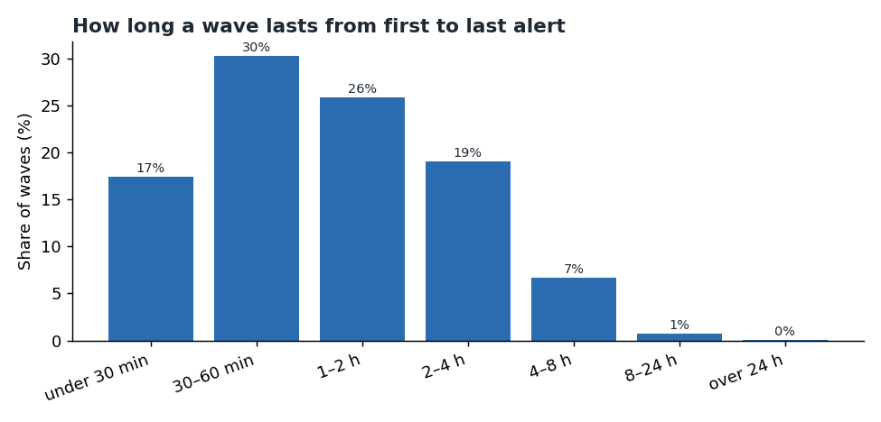
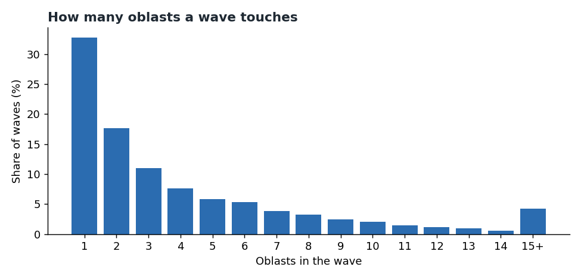
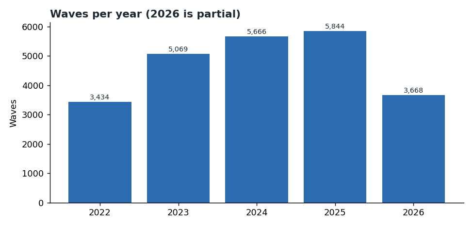

# Chapter 3: Waves and clusters

*How alerts group into waves, how long a wave lasts, how many oblasts (regions of Ukraine) a wave touches, and how that has
changed.*

Source: the volunteer alert record, 25 February 2022 to 11 October 2026. Reproduce everything with
`python -m scripts.chapter03_waves`.

A **wave** is a run of alert starts in which each start comes no more than 30 minutes after the
previous one, counted across all oblasts together. This is the 30-minute gap: a wave is a burst of alerts with no
quiet period longer than 30 minutes. It is the primary setting. Chapter 1
introduced the idea; this chapter looks inside the waves.

A wave is a grouping of alert records only. It does not say what was launched, where it landed, or how
much notice people had.

---

## The short version

- **There are 23,681 waves** in the record at the 30-minute gap.
- **A typical wave spans about an hour** (median 64 minutes, the middle value, from the first alert
  start to the last recorded alert end; the time the alert records stayed open, not how long anyone was
  at risk). **One in ten lasts over three and a half hours** (90th percentile 212 minutes, the value
  only one in ten waves exceeds).
- **Waves usually touch few oblasts.** A third (33%) touch only one. The median is two, and one wave in
  ten reaches ten or more.
- **Since 2026, waves now touch more oblasts.** Nearly one wave in five (20%) now touches ten or more
  oblasts, against 6% to 11% in earlier years. The median has risen from 2 oblasts to 4. The 2026 comparison was
  checked only at the 30-minute gap and covers 284 days, not a full year, so it is not seasonally matched.
- **The longest wave may be a recording error.** It lasts 179 hours across 14 oblasts, driven by a single row of about 178 hours (Chapter 5). The other 15 alert records in that wave are short. It needs checking before anyone reads it as an event.

---

## 1. How long a wave lasts

| Wave length (first alert start to last alert end) | Share of waves |
|---|---:|
| Under 30 minutes | 17% |
| 30 to 60 minutes | 30% |
| 1 to 2 hours | 26% |
| 2 to 4 hours | 19% |
| 4 to 8 hours | 7% |
| 8 to 24 hours | 0.8% |
| Over 24 hours | 0.05% |

Just under half of all waves (48%) last under an hour, and about 92% last under four hours. Only about 2% of
waves exceed six hours. Those long waves need care: they can be long stretches of repeated alert records or
artefacts of how the record was kept. Chapter 5 examines them.

**Within a wave, the alerts are spread out.** The median time from the first start to the last start
in a wave is **9 minutes**, and the 90th percentile is **70 minutes**. So most waves are a short burst
of starts, with the duration mostly coming from how long each alert record stays open.

---

## 2. How many oblasts a wave touches

- **One oblast:** 33% of waves.
- **Two oblasts** (the median): the typical wave.
- **Ten or more:** about 1 wave in 10.
- **23 or more:** about 1.5% of waves (366 waves).

194 waves (0.8%) touched all 24 oblast names in the alert record. They occur in every year: 42 in 2022, 69 in 2023,
45 in 2024, 25 in 2025 and 13 in 2026 (to 11 October). The count does not single out one period.

---

## 3. Waves over time

| Year | Waves | Waves touching 10+ oblasts | Share of that year's waves | Median oblasts per wave |
|---|---:|---:|---:|---:|
| 2022 (from 25 Feb) | 3,434 | 393 | 11% | 2 |
| 2023 | 5,069 | 328 | 6% | 2 |
| 2024 | 5,666 | 514 | 9% | 2 |
| 2025 | 5,844 | 490 | 8% | 2 |
| 2026 (to 11 Oct) | 3,668 | 727 | 20% | 4 |

The number of waves per year rose from 2022 (a partial year, from 25 February) to 2025. 2026 has 3,668 waves in 284 days, about 12.9 per day, against 16.0 per day in 2025 (5,844 waves in 365 days).
The change that stands out is in **breadth**: a larger share of recorded waves group starts in ten or more
oblasts (20% in 2026, against 6% to 11% earlier). No cause is identified here. The 2026 comparison was checked only at the 30-minute gap and covers 284
days, not a full year, so it is not seasonally matched. Chapter 2 showed the same
shift in the share of alerts by region.

**Read this with care.** The 2026 change may reflect the events, the way the volunteer record was kept,
or both. The record cannot separate them, and this chapter does not test either explanation. Chapter 8 looks at the reporting side.

---

## 4. The longest wave

The longest wave in the record began on **4 March 2022**. It lasts 179 hours (about seven and a half
days) and touches 14 oblasts. The duration is driven by a single row of about 178 hours (Chapter 5).
The other 15 alert records in that wave are short. The record does not say whether that row is real.
Chapter 5 checks it against the long-alert register (the list of records lasting over six hours).

---

## 5. Sensitivity to the gap

The 30-minute gap is a choice. Changing it changes the picture.

| Gap | Waves | Median oblasts | 90th percentile oblasts | Median duration (min) | Share over 6 hours |
|---|---:|---:|---:|---:|---:|
| 5 min | 61,588 | 1 | 3 | 34 | 0.6% |
| 10 min | 48,970 | 1 | 5 | 39 | 0.7% |
| 15 min | 39,974 | 2 | 6 | 45 | 0.9% |
| **30 min (primary)** | **23,681** | **2** | **10** | **64** | **2.3%** |
| 60 min | 10,543 | 5 | 16 | 113 | 12.9% |

A shorter gap splits waves into many small bursts. A longer gap joins separate bursts into fewer, larger
waves. At 60 minutes, about one wave in eight lasts more than six hours, consistent with chaining joining
separate bursts. The 30-minute setting is a reasonable middle, but **no single gap is correct**. Any
headline number about waves should name its gap.

---

## What this chapter cannot tell you

- **What caused a wave.** A wave is a grouping of records, not a known attack.
- **What was launched.** The record does not record threat types.
- **How much notice people had.** There are no launch or impact times.
- **Whether a long wave was real.** The longest waves may be record artefacts, and Chapter 5 tests that.

---

## Method

- **Data:** the volunteer alert record, 115,989 rows after removing exact duplicates.
- **Waves:** start instants (distinct start times across all oblasts) are sorted. A new wave begins
  whenever the gap to the previous instant is more than the gap setting.
- **Duration:** from the earliest start to the latest recorded end in the wave.
- **Spread:** from the earliest start to the latest start in the wave.
- **Oblasts per wave:** the number of distinct oblast names in the wave.
- **Years:** calendar year in Kyiv time. The 2026 figures cover 1 January to 11 October.
- **Script:** `scripts/chapter03_waves.py`. The wave table is saved to `output/analysis/`
  (gitignored).
