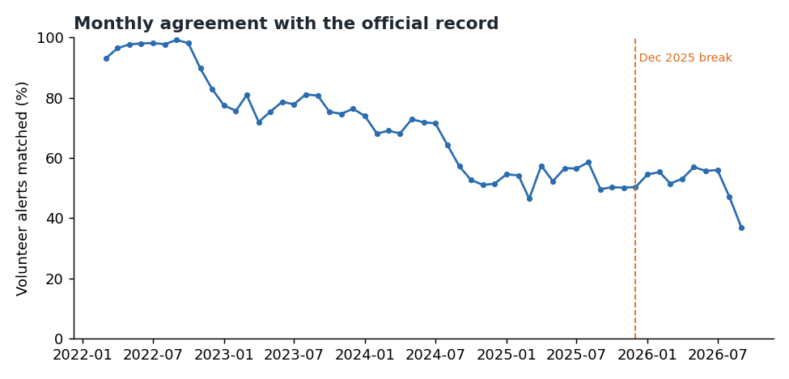
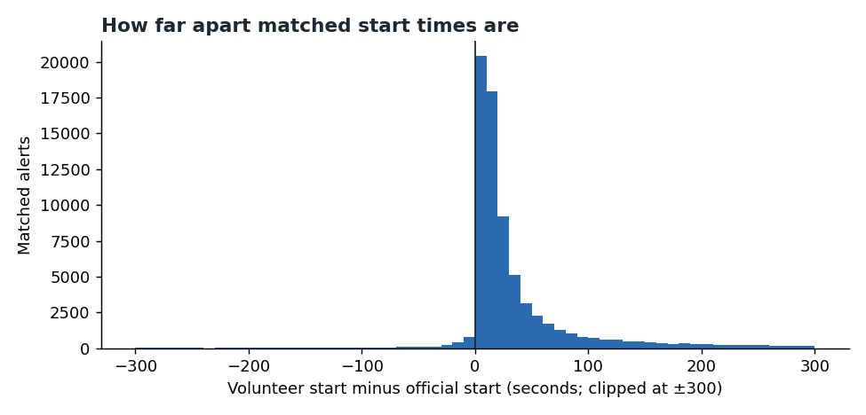
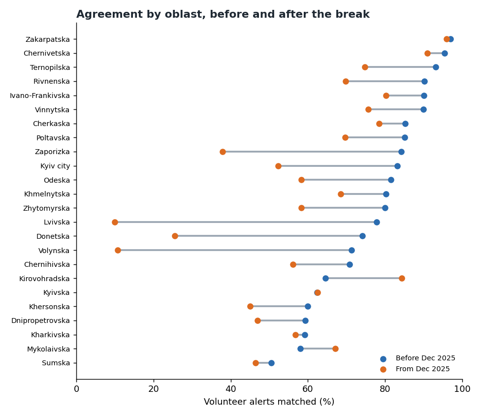

# Chapter 4: How far the record can be trusted

*How well the volunteer alert record agrees with the official record, over time and by oblast.*

Source: the volunteer alert record (25 February 2022 to 11 October 2026) and the official record (15
March 2022 to 7 September 2026). Reproduce everything with `python -m scripts.chapter04_reliability`.

**Agreement is not accuracy.** The official record is a cross-check, not ground truth, and nothing in
this project independently checks the volunteer record. A low match rate means the two records disagree.
It does not show which one is right. Where the two agree, that is evidence, not proof.

**How matching works.** A volunteer alert is *matched* if an official alert in the same oblast starts
within five minutes of it. Five minutes is the project's standard (see the tolerance table in section 4).

---

## The short version

- **About two in three volunteer alerts (65%) match an official alert** over the whole period. The
  official record matches about four in five (79%) of its own oblast-level alerts.
- **Agreement fell steadily from 2022 to 2025, then levelled off.** It fell by about 12 percentage
  points a year between 2023 and 2025, and has stayed near 54% since.
- **There is no step at the December 2025 break.** The six months either side average the same (53%).
  An earlier version of this analysis read the break as the cause of a drop. The data does not support that.
- **Some oblasts did drop sharply after the break.** Lvivska fell from 78% to 10% and Volynska from 71% to
  11%. Donetska and Zaporizka also fell sharply. These are real differences between the records, not
  part of the national trend.
- **When both records catch an alert, they agree closely on the time.** Most matched pairs (84%) start
  within a minute of each other, and the volunteer record is usually a few seconds later.

---

## 1. Agreement over time

Agreement was high in the first months of the record and then declined in most years. The share of
matched volunteer alerts was about 98% in mid-2022, about 80% in early 2023, about 70% in 2024 and
about 55% by 2025.

| Measure | Value |
|---|---:|
| Matched alerts, whole period (Mar 2022 to Sep 2026) | 65% |
| Matched, six months before the break (Jun to Nov 2025) | 53% |
| Matched, six months after the break (Dec 2025 to May 2026) | 54% |
| Trend in 2023 to 2025 | about −12 points per year |

The two six-month windows match each other, so the break itself is not a step in the national figure.
The decline was already under way before it.

**Two cautions.** The series is monthly and the last month is partial. The early months are also
affected by the start of the official record in March 2022.

---

## 2. How far apart matched alerts are in time

For matched pairs, the median gap between the volunteer start and the official start is **16 seconds**.
The middle half (interquartile range) falls between **7 and 36 seconds**. **84%** of matched pairs start
within a minute of each other.

The volunteer record is usually a few seconds *later* than the official one, which fits a volunteer
recording an alert after it is announced.

**This is not warning time.** The gap measures how quickly two records were written. It says nothing
about how much warning anyone had before an alert started, and must not be presented that way
(see [SAFETY.md](../SAFETY.md)).

---

## 3. Agreement by oblast

The dumbbell chart shows each oblast's match rate before and after the break. It includes the 24
oblasts with at least 50 alerts in both periods. Luhanska has two alerts before the break and none
after, so it is flagged and not scored.

Three patterns stand out:

- **Largest falls:** Lvivska (78% to 10%), Volynska (71% to 11%), Donetska (74% to 26%) and Zaporizka
  (84% to 38%). These fall far more than the national average.
- **Stable or rising:** Kirovohradska (65% to 84%), Mykolaivska (58% to 67%) and Cherkaska (85% to 79%)
  stay close to their earlier levels, or improve.
- **High throughout:** the far west, Zakarpatska (97% before, 96% after), Chernivetska (95% before, 91%
  after) and Ivano-Frankivska (90% before, 80% after) keep high agreement. That fits the wave-level
  finding in Chapter 3 that western waves reach many oblasts together.

Twenty-one of the 24 scored oblasts fell after the break. Most of that fall, however, is the same
gradual national trend shown in section 1. Only the sharper falls above need separate explanation.

The full table is in `output/analysis/chapter04_by_oblast.csv` (gitignored).

---

## 4. How the result depends on the tolerance

| Tolerance | Volunteer alerts matched | Official oblast alerts matched |
|---|---:|---:|
| 1 minute | 55% | 67% |
| **5 minutes (standard)** | **65%** | **79%** |
| 10 minutes | 69% | 82% |
| 30 minutes | 77% | 87% |

Widening the window from one minute to thirty adds about 22 points to the volunteer match rate. That
means part of the disagreement is timing, not a difference in whether an alert happened. The 5-minute
standard is a choice; reporting any match rate without its tolerance would overstate the precision.

---

## 5. Corrections to earlier figures

This chapter corrects two statements made earlier in this project:

1. **The pre-break figure.** The earlier value of 69.0% counted 1,149 volunteer alerts from before the
   official record starts (25 February to 14 March 2022) as unmatched. Restricted to the official
   record's coverage, the pre-break match rate is **70.0%**. The post-break figure of 52.7% is unchanged.
2. **The cause of the drop.** Earlier analysis presented the December 2025 break as the point where
   agreement fell. The six-month comparison above shows no step at that date. The decline is gradual
   from 2023. The break coincides with a change in the official record's granularity, which matters for
   comparisons (see Chapter 6), but agreement did not change at the same time.

The corrections are noted in `docs/gate3_results.md` and `docs/analysis/feed_integrity.md`.

---

## What this chapter cannot tell you

- **Which record is right.** Agreement shows where the two records line up, not which one is correct.
- **Why agreement fell.** The decline could reflect changes in how volunteers report, in what the
  official record includes, or in the events themselves. The data cannot separate these.
- **The reliability of the record after 7 September 2026.** The official record ends there, so no
  cross-check exists for the last five weeks.
- **Whether matched alerts are the same event.** A match is a timing match in the same oblast, not an
  identity match.

---

## Method

- **Window:** from the official record's first start (15 March 2022) to its last start (7 September 2026).
- **Precision:** share of volunteer alerts with any official alert (any level) in the same oblast within
  the tolerance.
- **Recall:** share of official oblast-level alerts with a volunteer alert in the same oblast within the
  tolerance. After the break the official record has only 472 oblast-level rows, so the post-break recall
  is a small sample.
- **Step test:** the six months before and after 1 December 2025, compared directly.
- **Trend:** a linear fit to monthly agreement from January 2023 to November 2025.
- **Lag:** volunteer start minus the nearest official start in the same oblast, for matched pairs.
- **Small samples:** oblasts with fewer than 50 alerts in a period are flagged and not scored.
- **Script:** `scripts/chapter04_reliability.py`. It reuses the matcher in `scripts/feed_integrity.py`.
