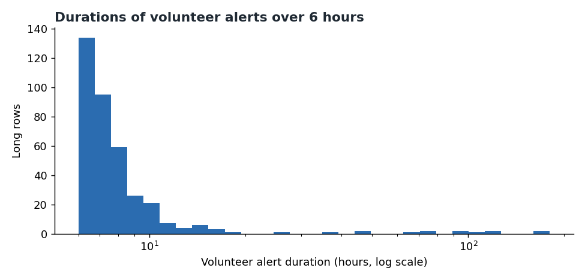
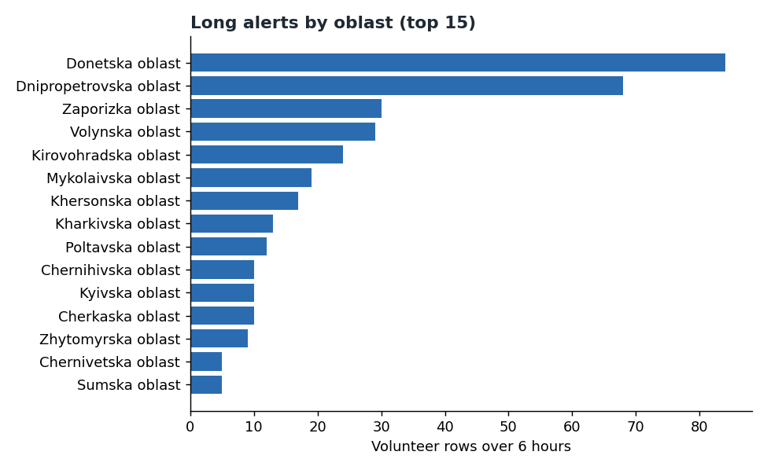
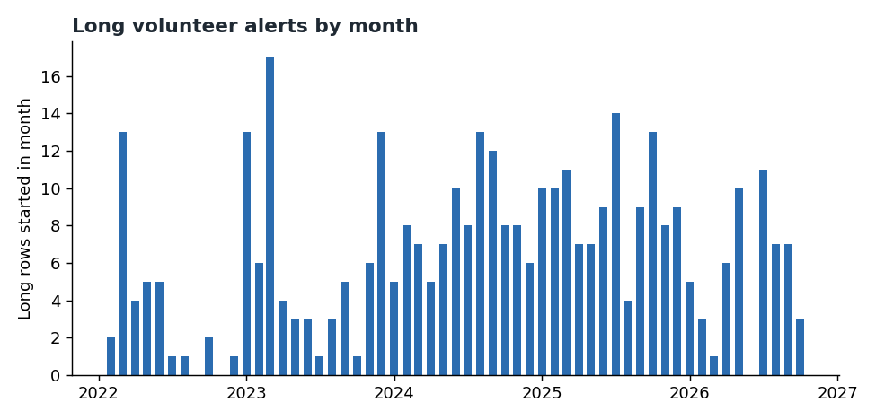

# Chapter 5: Long alerts

*The records whose recorded start-to-end span is more than six hours: how many there are, where and when they appear, and whether they can be trusted.*

**"Long" here means more than six hours of recorded time.** From this chapter you can learn how common such records are and how they line up with the official list. You cannot learn how long any siren really sounded.

Source: the *volunteer record* (a list of alerts kept by volunteers; 25 February 2022 to 11 October 2026,
115,989 rows) and, for the cross-check, the *official record* (the list kept by the official feed; 15 March
2022 to 7 September 2026). A *row* is one entry for one area, not necessarily one alert. An *oblast* is a
region. Times marked UTC are world clock time (Ukraine is two to three hours ahead); *local time* means Kyiv
time. The *median* is the middle value: half are above it, half below. A *ratio* says how many times longer
the volunteer entry is than the official one. Reproduce everything with
`python -m scripts.chapter05_long_alerts`.

**A long record may reflect a real siren period, or a recording error.** A *recording error* is an entry
whose end was not properly logged, so it looks far longer than it was. *Real* means the air-raid alert
really lasted that long. For most long records the data cannot say which it is. This chapter lays out the evidence on both sides. It does not settle the question.

---

## The short version

- **Long alerts are rare.** 370 of 115,989 rows (0.3%) last more than 6 hours. 28 last more than 12
  hours and 14 last more than 24 hours. The longest single row is 178.3 hours.
- **Donetska and Dnipropetrovska account for 152 of the 370 long records.** This counts records, not danger.
  23 areas have at least one.
- **They happen throughout the record.** The number of records rose from 2022 to 2025; total alerts also changed, so this does not show more danger. 2026 is partial.
- **The integrity tests are mixed.** No long row has an end time the data filled in by rule (not one that was recorded), and none has an end time
  that is the same as another entry's. But only 45% have an official start nearby, and about one in eight of those that do is at least
  three times longer in the volunteer record.
- **One cluster fits a recording error; not proven.** Four western oblasts on 17 April 2026 show alerts of 108 to 177
  hours, while the official record shows alerts of about 18 minutes at about the same time.
- **For 2026 the oblast-level check cannot be done.** After December 2025 the official record has oblast-level rows only for Kyiv City (472 rows in total; 448 in 2026, all Kyiv City). For every other oblast the oblast-level check cannot be done for 2026.

---

## 1. What counts as a long alert

A *long alert* is a volunteer-record row whose end minus start is **over 6 hours**. The 6-hour line is a
choice made for this chapter. There are no negative durations in the data.

| Threshold | Rows | Share of 115,989 |
|---|---:|---:|
| Over 6 hours | 370 | 0.32% |
| Over 12 hours | 28 | 0.02% |
| Over 24 hours | 14 | 0.01% |

(Shares are my division of the row counts by the total.) Among the 370, the median length is 7.2 hours and
the longest is 178.3 hours.

**Rows are not waves.** This chapter counts single rows (one oblast, one alert). Chapter 3 groups rows
into *waves*, runs of starts with no gap longer than a set number of minutes. They give different counts.
There are **14 rows** over 24 hours, but only **11 waves** over 24 hours at the 30-minute gap. The two
numbers describe different things and should not be swapped.

---

## 2. Where they are

| Oblast | Long rows |
|---|---:|
| Donetska | 84 |
| Dnipropetrovska | 68 |
| Zaporizka | 30 |
| Volynska | 29 |
| Kirovohradska | 24 |
| Mykolaivska | 19 |
| Khersonska | 17 |
| Kharkivska | 13 |

Twenty-three areas have at least one long row. The remaining 15 areas in the figure are in
`output/analysis/chapter05_numbers.json`.

These are counts of long records, not measures of danger. They depend on how each area is reported, and the
counts are not adjusted for how many alerts each area has in total.

---

## 3. When they happen

| Year (UTC) | Long rows |
|---|---:|
| 2022 | 34 |
| 2023 | 75 |
| 2024 | 97 |
| 2025 | 111 |
| 2026 (partial, to 11 Oct) | 53 |

2026 is a partial year, so its count is not comparable with the full years. The monthly figure shows
spikes (for example March 2023 with 17 and January and December 2023 with 13 each) and three empty months (September and November 2022, June 2026).

**Start hour.** Of the 370 long rows, 17.0% start in the hour beginning 23:00 (local time), 12.4% at 22:00,
12.7% at 00:00 and 10.8% at 01:00. Across all alerts the equivalent shares are 4.2% to 4.7%. So more long records are opened in the late evening and just after midnight. This says nothing about when attacks happen. It describes
the records only, and this chapter offers no explanation for it.

**Clustering in time.** 31% of long rows start within 24 hours of the previous long row, and 29% fall on
a local day with two or more long rows. The busiest day, 9 March 2023, has 8.

---

## 4. Integrity tests

Four tests, each asking whether long rows look like recording errors.

| Test | Result | What it says |
|---|---|---|
| End time filled in by rule, not recorded | 0 of 370 long rows, against 5.0% of all rows | The long rows are not products of that rule |
| End times that are the same across entries | 370 distinct end times for 370 rows; none the same. Across all rows 5.5% share an end time | The ends are not shared, so there is no sign of one batch close. An alert that is simply never closed would not show up here. |
| Official start nearby (any level) | 167 of 370 (45%) | Fewer than half have an official counterpart |
| Official start nearby (oblast level) | 120 of 370 (32%) | Fewer still at the strictest level |

"Nearby" means an official alert in the same oblast starts within 5 minutes (the standard from Chapter 4).

**Duration compared with the official record.** For the matched pairs we can compare the two durations.

| Measure | Any level | Oblast level |
|---|---:|---:|
| Matched long rows | 167 | 120 |
| Median volunteer length / official length | 1.00 | 1.00 |
| Pairs where volunteer is at least 3 times longer | 21 (12.6%) | 3 (2.5%) |
| Median official length (hours) | 6.7 | 6.7 |

When an official match exists, the typical pair agrees closely on length. The median official length
(6.7 hours) is itself over six hours. That supports "both feeds recorded a long span". It does not show that the
alert was real. Matched pairs are also a selected group (those with an official start nearby), and the official
feed may carry the same recording error.

The 21 pairs at 3 times or more are the main concern, and the 17 April cluster below accounts for four of them. 11 of the 21 matched pairs at three times or more last at least 15 hours with ratios above 40; the 17 April cluster is the only one analysed in detail here. That 17 April wave is also the second-longest wave in the record (177.2 hours, 26 records, 24 oblasts); the 22 other records in it are not discussed here. Examples from the row-level file (volunteer start UTC, length, ratio): Chernivetska 2025-03-03 (77.9 h, 199), Khmelnytska 2026-08-04 (69.9 h, 239), Ternopilska 2026-08-28 (93.9 h, 240), Zhytomyrska 2026-07-24 (36.5 h, 187), Kirovohradska 2026-07-17 (15.3 h, 40).

**What the tests do not show.** The 203 long rows with no official match at any level (370 minus 167) are untested.
Not matching does not mean the alert was false. Chapter 4 shows the two records disagree: about a third of volunteer alerts have no official start within five minutes.

---

## 5. The clearest candidate recording error: 17 April 2026

Four western oblasts have long rows that begin within about three minutes of each other on 17 April 2026
(UTC, about 16:52 to 16:56).

| Oblast | Volunteer start (UTC) | Recorded length (hours) | Official length at that start (hours) |
|---|---|---:|---:|
| Zakarpatska | 16:52:42 | 122.4 | 0.30 |
| Ternopilska | 16:55:41 | 121.0 | 0.29 |
| Khmelnytska | 16:55:46 | 108.0 | 0.29 |
| Chernivetska | 16:55:46 | 177.2 | 0.30 |

The recorded lengths run from 108 to 177 hours, which is 4.5 to 7.4 days. The official record has raion-level rows in each of the four oblasts, starting about 16:52 and ending about 17:10 (about 18 minutes). None of the four has an oblast-level match. The volunteer length is 368 to 600 times
the official one. (The official lengths and ratios are taken from rows in
`output/analysis/chapter05_long_alerts.csv`. They are not in the summary JSON.)

Several alerts starting close together is a normal pattern in the records. Four alerts that all fail to close for days,
while the official record closes each within 20 minutes, is a multi-day record in one feed against an 18-minute record in the other. The pattern fits a failure to record the ends. It does not prove it. The data cannot rule
out a real long alert that the official record chose to represent differently.

---

## 6. The longest wave

At the 30-minute gap, the longest wave started on **4 March 2022** and ran **178.8 hours** (about 7.5 days),
with **16 records across 14 oblasts**. That is about 0.09 records per hour, which is below the flagging threshold of one record per three hours. 7 of the 20 longest waves are flagged this way. The wave is long because one Zaporizka row lasts about 178 hours (178.3): it starts at 08:02 UTC on
4 March 2022 and ends at 18:18 UTC on 11 March. It is not known whether this record is real or unclosed. The other 15 records are short, mostly 0.2 to 0.6 hours, and
one is 1.6 hours. The wave begins 32 minutes before that long row starts, with a short Zhytomyrska alert
(07:30 UTC), so the wave runs 178.8 hours against 178.3 for the longest single row. The low record rate reflects
that.

---

## 7. The 2026 limit

After December 2025 the official record has oblast-level rows only for Kyiv City (472 rows in total; 448 in 2026, all Kyiv City). For every other oblast the oblast-level check cannot be done for 2026. The oblast-level cross-check in section 4 is therefore blind for 2026: 0 of the 53 long rows in 2026 have an oblast-level match. (This agrees with Chapter 4's "472 oblast-level rows", which counts the whole post-break period.) The 53 long rows in 2026 can only be
checked at the any-level standard, which is looser. The 17 April cluster above was caught that way.

---

## What this chapter cannot tell you

- **Whether a given long alert was real.** The data cannot decide this for most cases.
- **Why long alerts cluster in certain oblasts or at night.** The records show the pattern, not the cause.
- **What kind of alert it was, or what it was for.** The feed does not record this.
- **How long anyone was at risk.** Duration is the time between two records. It says nothing about warning
  time, safety or conditions on the ground.
- **Anything about 2026 at oblast level**, because after December 2025 the official record has oblast-level rows only for Kyiv City.
- **A ranking of oblasts.** The counts in section 2 describe records only.

---

## Method

- **Definition:** long alert = volunteer-record row with duration over 6 hours. 28 over 12 hours and 14 over
  24 hours use the same row basis.
- **End times filled in by rule, not recorded:** rows flagged as such by the data loader (the `naive` column in the row file).
- **End times that are the same across entries:** count of distinct end timestamps among long rows.
- **Official cross-check:** an official start in the same oblast within 5 minutes, at any granularity level or
  at oblast level only. Duration ratio is volunteer length divided by official length for the same pair.
- **Start hour:** local time of the volunteer start.
- **Waves:** 30-minute gap, as in Chapter 3.
- **Figures and numbers:** `scripts/chapter05_long_alerts.py`; summary in
  `output/analysis/chapter05_numbers.json`, row-level detail in `output/analysis/chapter05_long_alerts.csv`
  (gitignored).
- **Computed by the writer, not by the script:** the percentage shares in the section 1 table, the "152 of
  370" sum, the 203 unmatched count, and the 4.5 to 7.4 day conversions. All are simple arithmetic on the cited numbers.
