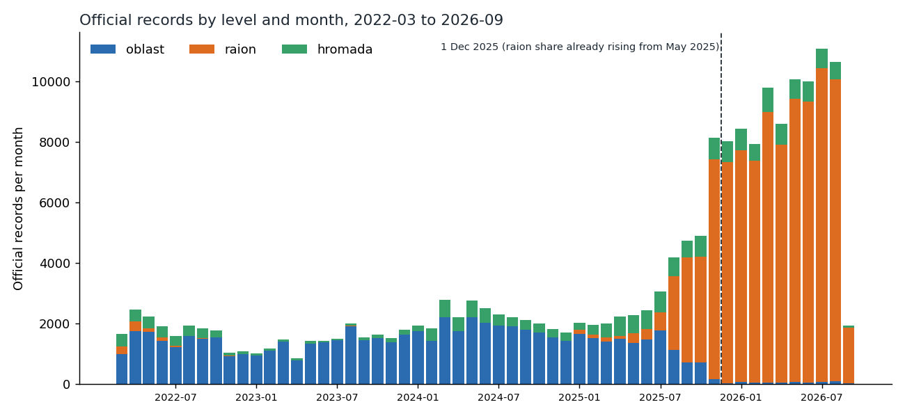
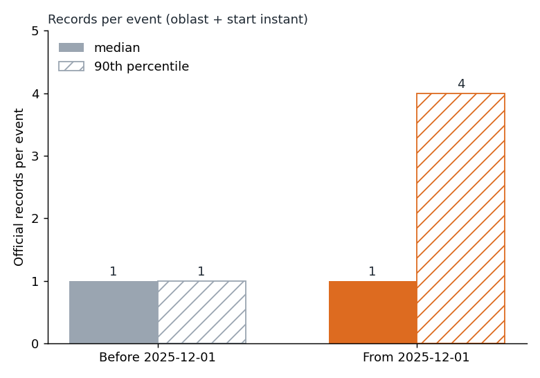

# Chapter 6: Granularity and the official feed

*How the official record changed from listing whole regions to listing districts, how gradually that change came, and what it does to row counts and to the match rate used in Chapter 4.*

This chapter does not say whether there were more or fewer alerts. It shows that the official list changed how it records them.

**"Granularity" here means the size of the area one row describes.** From this chapter you can learn how the official record's rows changed in kind and in number. You cannot learn why it changed, or whether more or fewer events happened.

Source: the *official record* (the list kept by the official feed; 15 March 2022 to 7 September 2026, 185,430
rows) and the *volunteer record* (a list of alerts kept by volunteers), used here only for comparison. A *row* is
one line in the official list. A row is a line in a list; it is not an alert. An *oblast* is a region. A *raion* is a district inside an
oblast. A *hromada* is a community, smaller still. UTC is world clock time; Kyiv is two to three hours ahead.
The *median* is the middle value: half are above it, half below. A volunteer alert counts as *matched* if the
official list has an entry for the same region starting within five minutes. Reproduce everything with
`python -m scripts.chapter06_granularity`.

**Before 1 December 2025 and after it are not directly comparable.** This chapter uses 1 December 2025 as the marker for the format change, as Chapter 4 does. It shows that the date is a convenient marker, not a
clean cut: the record's share of district rows first rose in January 2025 and had passed half by August 2025.

---

## The short version

- **The official record moved from regions to districts.** Before 1 December 2025, oblast-level rows were the
  largest group (64,842). After it, raion rows are (79,980).
- **The change came in stages.** Raion rows were about 4 to 8% of rows in early 2025, 14 to 20% in May to July 2025, 58% in
  August and 73% in September. The share first rose in January 2025, rose again from May 2025, and passed half in August 2025; The share was 89% in November. This is the share of lines that name a district, not the share of alerts.
- **The official list now has more rows for each start time for one region, and more start times.** It has about four times as many rows per region per day (2.92 before, 12.82 after, 4.4 times). Two things combine. Separate start times for one region per region per day went from 2.85 to 8.63 (about 3.0 times). Rows per start time for one region went from 1.02 to 1.49 (about 1.45 times). So most of the rise is in how many separate start times were logged, and only part is several rows sharing one start. This measures rows; the data cannot say whether that reflects recording or events.
  The official list has about 2.4 times as many rows for each volunteer-logged alert (1.23 before, 2.96 after), which says nothing about how many alerts there were. This is official rows divided by volunteer-logged alerts, each taken as a total over the whole period. The 4.4 and 2.4 depend on the volunteer count, which may have changed too.
- **Matching depends on which official rows count.** Counting oblast-level rows only (Kyiv City only after the change), 63.7% of volunteer alerts match
  before the change and 1.0% after. The 1.0% is about the form of the rows, not about alerts. Counting all levels (oblast, district and community rows), 70.0% and 52.5%.
- **After the change, oblast-level rows are only Kyiv City:** 472 rows, of which 448 are in 2026.

---

## 1. What the rows look like, before and after

Each official row carries a level: oblast, raion or hromada.

| Level | Before 1 Dec 2025 | After 1 Dec 2025 |
|---|---:|---:|
| Oblast | 64,842 | 472 |
| Raion | 19,324 | 79,980 |
| Hromada | 14,787 | 6,025 |

(Before: 98,953 rows over 1,357 days. After: 86,477 rows over 281 days.)

Hromada rows are not new. They are 14.9% of rows before the change and 7.0% after, and the first is on 15 March
2022. The shift is in the oblast and raion groups.

---

## 2. The change came in stages

Share of each month's official rows that are raion rows (the share of lines that name a district, not the share of alerts):

| Period | Raion share |
|---|---:|
| 2024 (all months) | 0% to 0.1% |
| Jan to Apr 2025 | about 4 to 8% |
| May to Jul 2025 | 14 to 20% |
| Aug 2025 | 58% |
| Sep 2025 | 73% |
| Oct 2025 | 71% |
| Nov 2025 | 89% |
| Dec 2025 onward | about 91 to 94% |

The share was near zero through 2024, first rose in January 2025, rose again from May 2025, and passed half in August 2025. It had reached
89% by November, a month before the date. **The December 2025 date is therefore not a clean cut, and
the "before" period includes a change that came in stages: a first rise in January 2025, then mainly May to November 2025 (seven months).** Anything described below as "before" mixes
the old form with a growing share of the new one. Section 4 gives a check using a different comparison period.

---

## 3. Several rows for one start time

A *start time for one region* here is a group of official rows that share the same oblast and the same official start time. It is not necessarily one alert, and not one siren. Counting official rows per start time for one region:

| Measure | Before | After |
|---|---:|---:|
| Start times for one region (oblast and start time) | 96,689 | 58,170 |
| Median raion rows per start time for one region | 0 | 1 |
| 90th percentile of raion rows per start time for one region (the value that 9 in 10 stay at or below) | 1 | 4 |
| Share of start times for one region with any raion row | 17.7% | 88.9% |
| Mean rows per start time for one region (all levels) | 1.02 | 1.49 |

Before the change the middle start time for one region had no raion row at all; it had only the single oblast row. After, the
middle one has one raion row, and about one in ten has four or more rows. So one start time in one
oblast can carry several rows. Counting rows after the change is not the same measure as counting rows before it.

---

## 4. How much the row counts grow

| Measure | Before | After | After / before |
|---|---:|---:|---:|
| Official rows per region per day | 2.92 | 12.82 | 4.4 |
| Start times for one region, per region per day | 2.85 | 8.63 | 3.0 |
| Mean rows per start time for one region | 1.02 | 1.49 | 1.45 |
| Official rows divided by volunteer-logged alerts (totals over the period) | 1.23 | 2.96 | 2.4 |

The first row is the product of the next two (2.85 x 1.02 is about 2.92; 8.63 x 1.49 is about 12.82), so about 3.0 times from more separate start times and about 1.45 times from more rows per start time combine to 4.4 times. The last row is a ratio of totals: all official rows in the period divided by all volunteer-logged alerts in the period. The 4.4 and the 2.4 both depend on the volunteer count too: the 2.4 uses it directly, and the volunteer count may itself have changed. I compare against volunteer alerts as a rough guide, and I have not shown that its form is unchanged.

**Choice of comparison period.** The "before" period includes the gradual change described in section 2. As a check using a different comparison period, I used 1 January 2024
to 31 July 2025 instead. That gives 3.04 rows per region per day and 1.10 official rows per volunteer-logged
alert. The ratios against the after period become about 4.2 and 2.7. The main ratios hold with either
comparison period: official rows per day are roughly four times higher, and official rows per volunteer-logged alert more than doubled.

Do not read these as more or fewer alerts. This measures rows; the data cannot say whether that reflects recording or events.

---

## 5. Names

- 25 region names appear before the change and 24 after (Kyiv City, a city, counts as a region here). The one that drops is Luhanska oblast, which has a
  single official row, on 24 March 2022.
- Kyiv City has oblast-level rows only: 1,795 before and 472 after. Its first row after the change is on 3 December
  2025. All 448 oblast-level rows in 2026 are Kyiv City.
- Every region name in the volunteer record matches an official name exactly, so name matching is not a source of
  mismatch.

---

## 6. What this does to matching

Chapter 4 counts a volunteer alert as matched if the official list has an entry for the same region starting within five minutes.
Which official rows are allowed to count changes the answer a great deal. Under the all-levels count, a district row inside the oblast that starts within five minutes counts as a match.

| Official rows counted | Before | After |
|---|---:|---:|
| Oblast-level rows only (Kyiv City only after the change) | 63.7% | 1.0% |
| All levels (oblast, district and community rows) | 70.0% | 52.5% |

(Volunteer alerts: 80,682 before, 29,206 after.)

The oblast-only rate collapses because the rows it would match have mostly gone. After the change there are
472 oblast-level rows, all Kyiv City, so almost no volunteer alert can match one. Only Kyiv
City alerts can match here, so the 1.0% says nothing about other oblasts. **The all-levels figure is the one used in Chapter 4.**
Even there, the lower match rate after the change cannot by itself show that the lists agree less: the match was made against rows of a different kind.

---

## What this chapter cannot tell you

- **Why the official feed changed granularity.** The data shows when and how, not why.
- **Whether the change reflects more or fewer events.** The rows alone cannot separate a change in recording from a change in events.
- **Whether the official record is complete.** Neither list is a complete, verified record of what happened.
- **Anything about threats.** The rows do not record what an alert was for, and the counts here say nothing about danger.

---

## Method (technical appendix)

- **Levels:** the level column of the official record (oblast, raion, hromada). Cut date: 1 December 2025,
  **in UTC**. Kyiv local midnight is 22:00 UTC on 30 November, so rows in those two hours are counted before
  the cut here.
- **Window:** 15 March 2022 to the calendar date 7 September 2026. This includes 117 volunteer alerts that
  start after the official feed's last start (05:28 UTC that day). Chapter 4 cut the window at that last start,
  so its figures differ slightly. For example, its all-levels rate after the change is 52.7% and this chapter's is 52.5%.
  The rate before is 70.0% in both.
- **Start time for one region:** one oblast and one official start time. These measures are counted per start time for one region.
- **Matching:** same oblast, official start within 5 minutes of the volunteer start, for oblast-level rows only
  or for all levels. A nearest-match check against a brute-force search found 0 disagreements.
- **Comparison period check:** 1 January 2024 to 31 July 2025 (578 days, 38,372 volunteer alerts).
- **Figures and numbers:** `scripts/chapter06_granularity.py`; summary in
  `output/analysis/chapter06_numbers.json`, monthly counts in `output/analysis/chapter06_levels_by_month.csv`.
- **Calculated by hand from the table values, not by the script:** start times for one region per region per day (2.85 = 96,689 / (1,357 days x 25 names); 8.63 = 58,170 / (281 days x 24 names)), their ratio 3.0, the rows-per-start-time ratio 1.45 (1.487 / 1.023, from `records_per_event_mean`), the ratio 2.4 (the JSON gives 2.415), the ratios 4.2 and 2.7
  (12.82 / 3.04 and 2.96 / 1.10) and the rounding of raion shares to ranges. The arithmetic that May to
  November 2025 is seven months is also mine. Chapter 4's 52.7% is quoted from that chapter.
