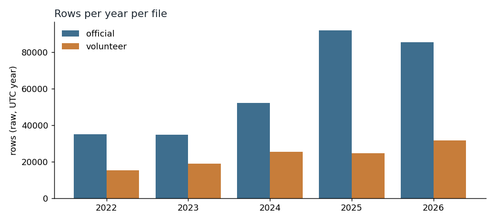

# Chapter 7: Data provenance and quality

*Where the two files come from, how they were checked, and what is wrong or missing in them.*

This chapter does not say how many alerts there were. These files are the source for every other chapter, so this one shows what they can and cannot be trusted for.

**Here, "quality" means only: the file is laid out correctly, its rows agree with each other, and the specific errors listed below are absent.** From this chapter you can learn what each file contains, what was removed or flagged, and where gaps are. You cannot learn whether either file is correct about what happened on the ground.

Source: the *official record* is the list kept by the official feed. The *feed* is the official alert system's data stream. The *volunteer record* is a list of alerts kept by volunteers. Both are files in one public repository.

Terms used below. A *row* is one line in a file. *Raw rows* are every line in the file, before removing copies. An *oblast* is a region; a *raion* is a district inside an oblast; a *hromada* is a community, smaller still.

More terms. The *median* is the middle value: half are above it, half below. UTC is world clock time; Kyiv local time is UTC+2 in winter and UTC+3 in summer, so the gap changes with the season. A *recording error* is a value in the file that cannot be right as written, such as an end time before a start time. A *checksum* is a unique fingerprint code for each file (SHA-256 is the name of the method); if it matches, the file is the same one that was downloaded.

---

## The short version

- **Both files come from one public GitHub repository** and were downloaded together on 12 October 2026, 00:58 UTC. The copies match what was downloaded. That tells us nothing about whether the alerts listed are correct.
- **The official file is 38.0% exact copies** (rows identical in every column, so they are the same line repeated). 299,275 raw rows become 185,430 after removing 113,845 exact duplicates. The volunteer file has none.
- **Every day from 25 February 2022 to 11 October 2026 has at least one entry in the volunteer file.** That does not mean every alert was recorded. The official record has 3 empty days in a row (30 August to 1 September 2026). Empty days are reported, not filled.
- **5.0% of volunteer rows are marked in a column called `naive`, which marks alerts whose end time was estimated** (the project treats these as inferred end times). The official file has no such column.
- **All times are in one standard format (UTC, ending in +00:00).** This checks the format only, not whether the times are right.
- **The files hold almost no records for Luhanska oblast, so they say nothing reliable about it:** 3 volunteer rows and 1 official row.

---

## 1. What the files are

| | Official record | Volunteer record |
|---|---|---|
| File | `official_data_en.csv` | `volunteer_data_en.csv` |
| Repository | Vadimkin/ukrainian-air-raid-sirens-dataset (GitHub) | same |
| Raw rows | 299,275 | 115,989 |
| Rows after removing exact duplicates | 185,430 | 115,989 |
| First start (UTC) | 15 March 2022 | 25 February 2022 |
| Last start (UTC) | 7 September 2026 | 11 October 2026 |
| Size | 31,025,633 bytes | 8,907,112 bytes |
| SHA-256 | `b396f87696243069eec0219880e87dcd642b20beb0a7bae0d0e1f61e1ed20ec4` | `d03747ee8bf056032b2eeef50cdcf964d65fa60a92243e91862db48b31377465` |

The download was recorded in the project manifest on 12 October 2026 at 00:58 UTC. The size and SHA-256 of each file on disk match the manifest. The checksum shows the file is the one that was downloaded. It does not show that its contents are right.

---

## 2. Duplicates and shared start times

The official file contains 113,845 rows that are exact copies of another row: 38.0% of its raw rows. They are removed before any count in this project. The volunteer file has none.

Some rows share a start time but differ in end time. This is not an error. After removing exact copies, 9,173 official rows sit in 2,234 groups that share a region name and a start time but have different end times. (Counted before removing exact copies, the same groups hold 12,688 rows, 4.24% of raw rows; that figure includes the repeated lines.) For example, several districts in one region all logged an alert starting at 14:05, each ending at its own time. Each of these rows is a different district or community, so they do not contradict each other. The test: grouping rows by region, start time and district still leaves 66 rows with differing ends, and grouping by region, start time, district and community leaves none. ("Adding a field to the grouping" means treating rows as the same only if that field also matches.) So no single area has two different end times for one start. The volunteer file has no such rows.

---

## 3. Coverage over time

- **Volunteer record:** records on every one of 1,690 days, 25 February 2022 to 11 October 2026. No empty day.
- **Official record:** 1,638 days from 15 March 2022 to 7 September 2026; 1,635 have records. The 3 empty days are one run, 30 August to 1 September 2026. That is also the longest gap.

An empty day means the file has no row for it. It does not show that nothing happened, or that the feed was down; I cannot tell which. Empty days are left as missing and are never replaced with zeros.

Raw rows per UTC year. Years are counted in UTC; a Kyiv-year count would differ slightly.

| UTC year | Official | Volunteer |
|---|---:|---:|
| 2022 | 34,986 | 15,242 |
| 2023 | 34,724 | 19,046 |
| 2024 | 52,270 | 25,304 |
| 2025 | 91,878 | 24,653 |
| 2026 (to the file's end) | 85,417 | 31,744 |

The official raw count includes the duplicates from section 2, and its format changed over the period (see Chapter 6, on how the official list changed format). Do not compare the two columns, or read the official column as a trend in alerts.

---

## 4. Inferred end times

The volunteer file has a column called `naive`, which marks alerts whose end time was estimated (the project treats these as inferred end times). It flags 5,812 rows, 5.0% of the file. By UTC year:

| UTC year | Share of rows flagged `naive` |
|---|---:|
| 2022 | 2.0% |
| 2023 | 6.1% |
| 2024 | 5.6% |
| 2025 | 5.8% |
| 2026 | 4.7% |

Some durations in these rows are estimates, not measurements. The official file has no such column, so I cannot say how many of its end times were inferred.

---

## 5. Missing values and durations

**Official record.** Oblast, level, start, end and source are complete. Raion is missing in 43.5% of rows and hromada in 87.7%. This is expected: each row describes one level, so a row at oblast level has no raion or hromada, and a raion row has no hromada value. **Volunteer record.** All four columns (region, start, end, `naive`) are complete.

| | Official | Volunteer |
|---|---:|---:|
| Rows with zero duration | 4 | 6 |
| Rows with negative duration (recording error) | 0 | 0 |
| Median duration | 48.4 minutes | 30.0 minutes |

The two medians differ because the feeds record different things. The official feed writes several rows per event, at several area levels, so the two lists do not describe the same things in the same way (see Chapter 6, on how the official list changed format). Do not read the gap as one feed being more accurate.

---

## 6. Names and levels

Both files use the same 25 region names, including Kyiv City and Kyivska oblast as separate names. The two files use the same region names, so the names do not clash.

**Luhanska oblast.** The volunteer file has 3 rows for it; the official file has one (24 March 2022). Both files are nearly empty for this oblast, so neither supports any statement about it.

Official rows by level and UTC year, after removing duplicates:

| UTC year | Oblast | Raion | Hromada |
|---|---:|---:|---:|
| 2022 | 13,633 | 884 | 2,976 |
| 2023 | 16,243 | 12 | 1,107 |
| 2024 | 21,635 | 4 | 4,496 |
| 2025 | 13,355 | 25,722 | 6,900 |
| 2026 | 448 | 72,682 | 5,333 |

oblast = region, raion = district, hromada = community. The change from oblast to raion rows is covered in Chapter 6, on how the official list changed format.

---

## 7. Known edges and what is not in the files

- **Time zones.** Every timestamp in both files includes a time-zone label (UTC), and none failed to read. Local-day counts in this project use Kyiv time, converted from UTC.
- **Official first start:** 15 March 2022. The volunteer file starts about two and a half weeks earlier (18 days), on 25 February 2022.
- **Official last start:** 7 September 2026, 05:28 UTC. **Volunteer last start:** 11 October 2026, 04:36 UTC. Comparisons between the two stop at the official end.
- **Not in either file:** the type of threat, the cause of an alert, whether anything was hit, and any launch or impact time.

---

## What this chapter cannot tell you

- **Whether either file is correct or complete.** This chapter does not check either file against an independent record. Passing these checks shows the files are well formed, not true.
- **Why rows are missing or duplicated, or why several rows share a start time.** The files do not say.
- **Whether the 3 empty official days were quiet days or a gap in the feed.**
- **Which of several rows with the same start time describes the whole event.** They are rows for different districts or communities, not rival answers.
- **How many official end times were inferred.** The official file has no flag.
- **Anything about threats.** Counts of rows say nothing about danger.
- **A direct comparison of counts.** The official and volunteer feeds differ in what they record (area levels, inferred end times), so their counts are not interchangeable.

---

## Method (technical appendix)

- **Run the script:** `python -m scripts.chapter07_provenance`.
- **Checksums.** Verify a file yourself (run in `data/raw`; compare ignoring case, since PowerShell prints uppercase hex):
  - Linux or macOS: `sha256sum official_data_en.csv volunteer_data_en.csv`
  - Windows PowerShell: `Get-FileHash -Algorithm SHA256 official_data_en.csv, volunteer_data_en.csv`

  The output should equal the hashes in section 1. This checks the files against the project's own manifest (`data/raw/MANIFEST.json`), not against the repository's current version.
- **Exact duplicates:** rows identical in every column. **Shared start times:** groups of rows with the same region name and start but different ends. After removing exact copies: 9,173 rows in 2,234 groups (12,688 rows before removing copies). These are rows for different districts or communities within the same region that began at the same time. Adding the district field leaves 66 rows with differing ends; adding district and community leaves 0. The 9,173 and 66 were checked separately from the script and are not in `chapter07_numbers.json`.
- **Days and years:** days are Kyiv calendar days; years are counted in UTC.
- **Days (detail):** calendar days in Kyiv time, from the first to the last start in each file. A day is empty if no row starts on it.
- **`naive` share by year:** rows with `naive` true, over all raw rows that start that year (UTC year).
- **Durations:** end minus start, in minutes, on raw rows in both files (before removing duplicates).
- **Script and numbers:** `scripts/chapter07_provenance.py`; summary in `output/analysis/chapter07_numbers.json`; figure `docs/chapters/figures/ch07_coverage_by_year.png`.
- **Computed by the writer, not by the script:** the 38.0% share is 113,845 out of 299,275 raw rows.
