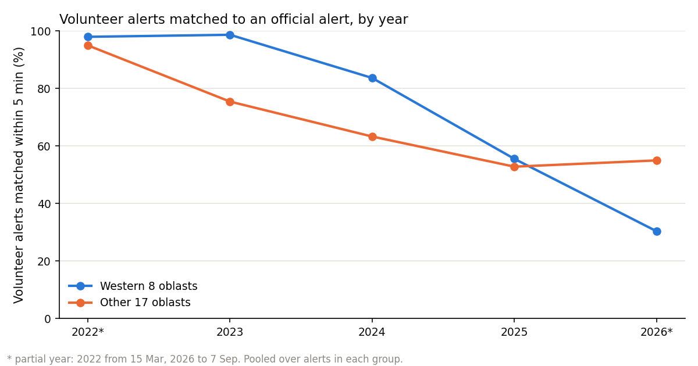
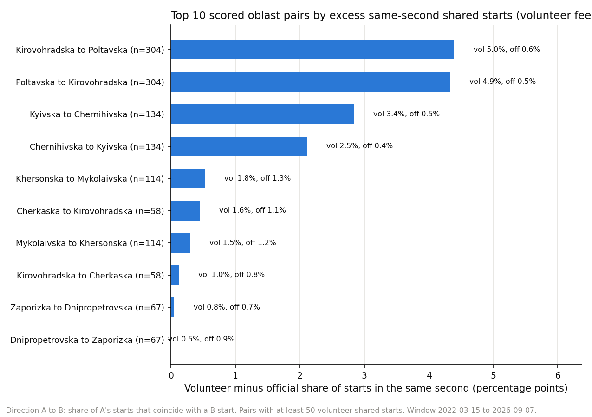
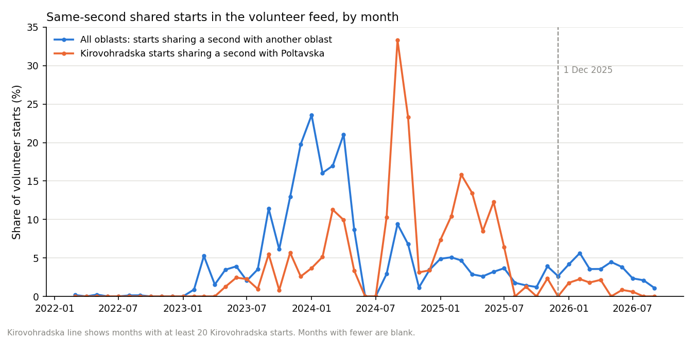

# Chapter 8: Reporting patterns

*How often the volunteer record agrees with the official record, by group of oblasts and over time, and how often alerts in different oblasts start in the same second.*

This chapter does not say where alerts were more frequent or more dangerous. It describes patterns in how the two records line up, so you can judge how far each can be trusted.

**"Agreement" here means that a volunteer alert has an official alert in the same oblast starting within five minutes.** From this chapter you can learn how that agreement changed by group of oblasts and year, and where same-second starts appear. You cannot learn which record is right, or why they differ.

Source: the *official record* (the list kept by the official feed) and the *volunteer record* (a list of alerts kept by volunteers), both from the public repository described in Chapter 7. All figures use the period where both exist: 15 March 2022 to 7 September 2026 (the last official start).

Terms used below. A *row* is one line in a file. An *oblast* is a region. The official file lists alerts at three levels: a whole oblast, a district inside it, or a smaller community. A *match* is a volunteer alert with an official alert in the same oblast starting within five minutes. *Any-level matching* means an official alert of any size (district, oblast or community) counts. The *match rate* is the share of volunteer alerts that are matched. The *median* is the middle value: half are above it, half below. *Western oblasts* means eight: Chernivetska, Ivano-Frankivska, Khmelnytska, Lvivska, Rivnenska, Ternopilska, Volynska and Zakarpatska. *Rest* means all other oblasts, including Kyiv City.

---

## The short version

This chapter checks how closely the volunteer and official lists agree, and how often starts in different oblasts are recorded at the same second.

- **The western group's match rate was slightly above the rest in 2022, well above it in 2023, and below the rest in 2026.** Its match rate was 98.6% in 2023 and 30.3% in 2026. 2026 is a partial year (to 7 September). The rest of the country fell from 94.9% (2022) to about 53 to 55% in 2025 and 2026.
- **Match rates in Lvivska and Volynska dropped from 77.7% and 71.2% to about 10%** after 1 December 2025. These figures use any-level matching.
- **Same-second starts are rare.** 4.8% of volunteer starts share their exact second with another oblast's start; for official oblast-level starts the figure is 4.5%. Only 10 of 600 ordered oblast pairs have at least 50 shared starts.
- **The data cannot say why starts are shared.** The records have no ID for each alert message.
- **Two earlier statements are corrected** (see "Corrections to earlier notes").

---

## 1. Western and other areas over time

Share of volunteer alerts matched within five minutes, combined across the oblasts in each group. 2022 starts on 15 March; 2026 ends on 7 September. Both years are partial.

| Year | West match rate | West alerts (n) | Rest match rate | Rest alerts (n) |
|---|---:|---:|---:|---:|
| 2022 (from 15 March) | 97.9% | 1,957 | 94.9% | 12,186 |
| 2023 | 98.6% | 1,656 | 75.4% | 17,390 |
| 2024 | 83.6% | 1,927 | 63.2% | 23,377 |
| 2025 | 55.5% | 1,784 | 52.8% | 22,869 |
| 2026 (to 7 September) | 30.3% | 2,149 | 54.9% | 24,476 |

The western agreement was high early and fell sharply through 2025 and 2026. The rest of the country fell more gradually. The pattern reverses over time: the western group's match rate was slightly above the rest in 2022 (97.9% against 94.9%), well above it in 2023, and below the rest in 2026. This chapter does not explain the cause.

Two oblasts show the late drop clearly. Match rate, all area levels, within five minutes:

| Oblast | Before 1 December 2025 | n | From 1 December 2025 | n |
|---|---:|---:|---:|---:|
| Lvivska | 77.7% | 896 | 9.9% | 718 |
| Volynska | 71.2% | 1,061 | 10.7% | 948 |

1 December 2025 is used as a marker date. Chapter 6 shows the official list changed format gradually from early 2025, so the date is not a clean cut. A fall in the match rate means fewer volunteer alerts have a matching official alert. It does not show which one changed.

---

## 2. Same-second starts by pair

*A shared start* here means a volunteer start whose timestamp is identical, to the second, to a start in another oblast. Two starts count as shared only if their timestamps match to the second, which is rare. Requiring an exact match to the second is strict, so the shares are low. Matching to the whole minute would count far more. For an ordered pair (A, B), the share is the part of A's starts that have a B start at the same second. Official oblast-level starts are used for comparison.

There are 600 ordered pairs of oblasts. Only 10 have at least 50 shared volunteer starts, so only these are included in the table. The five with the largest volunteer-minus-official difference:

| Oblast A | Oblast B | Shared starts (n) | Volunteer share | Official share |
|---|---|---:|---:|---:|
| Kirovohradska | Poltavska | 304 | 5.0% | 0.6% |
| Poltavska | Kirovohradska | 304 | 4.9% | 0.5% |
| Kyivska | Chernihivska | 134 | 3.4% | 0.5% |
| Chernihivska | Kyivska | 134 | 2.5% | 0.4% |
| Khersonska | Mykolaivska | 114 | 1.8% | 1.3% |

The "Shared starts" column is the volunteer count. The other five of the ten included pairs are not in the table above; they are in `output/analysis/chapter08_pair_batching.csv`, together with the pairs left out. One of the ten (Dnipropetrovska with Zaporizka) has a lower volunteer share than official. By chance alone, some oblasts that start alerts often will share a second sometimes; I did not model that.

The pair gaps in the table are not directly comparable: the official share covers the whole window, while official oblast-level rows thin out through 2025. The pairs are also selected on the volunteer side (at least 50 shared volunteer starts, ranked by volunteer minus official).

Overall, 4.8% of 109,771 volunteer starts are shared with another oblast. For official oblast-level rows it is 4.5% of 65,314, but the two cover different periods (the official file has almost no oblast-level rows after 1 December 2025), so they are not directly comparable.

---

## 3. Shared starts over time

Kirovohradska with Poltavska, volunteer record:

| Period | Kirovohradska starts (n) | Same second as a Poltavska start | Share |
|---|---:|---:|---:|
| Before 1 December 2025 | 4,992 | 294 | 5.9% |
| From 1 December 2025 | 1,063 | 10 | 0.9% |

The official oblast-level figure for the whole period is 0.6% of 3,344 Kirovohradska starts. After 1 December 2025 the official comparison cannot be made for this pair: the official file has no oblast-level rows for either oblast after that date (see Corrections). Monthly values are in `output/analysis/chapter08_batching_monthly.csv`; months with few starts are noisy.

---

## 4. Timing differences

For matched alerts, the median lag is the typical time gap between the volunteer start and the nearest official start, where a positive gap means the volunteer alert came later. Matched alerts only. The western and rest groups differ in their mix of official area levels (district, community, oblast) and of years, so the two medians are not a clean comparison.

| Group | Matched alerts (n) | Median signed lag |
|---|---:|---:|
| Western oblasts | 6,802 | 27.0 seconds |
| Rest | 64,979 | 15.0 seconds |

71,781 of 109,771 volunteer alerts are matched in total. These lags are differences in the timestamps of the two lists; the cause is not known. They are not warning time, and they say nothing about how long anyone had before an event.

---

## 5. What is not known

- **The cause of same-second starts.** The records have no ID for each alert message, so there is no way to tell whether alerts that share a second came from one message, one reporter, or something else. No cause is claimed.
- **Whether either record is accurate.** Agreement between two lists is not accuracy. A low match rate could come from either record, or from how they were put together.
- **Why the western match rate changed.** The chapter shows that it did, and when. It does not test explanations.

---

## Corrections to earlier notes

1. **The official record does have oblast-level rows after 1 December 2025.** There are 472, all for Kyiv City, after removing exact duplicates; the raw file has 551 Kyiv City oblast-level rows after 1 December 2025. For every other oblast the oblast-level check cannot be done after that date, because the official file has only district rows, plus some community rows in five oblasts (Dnipropetrovska, Donetska, Kharkivska, Zaporizka, Zhytomyrska).
2. **Pre-break Kirovohradska with Poltavska shared-start figure.** An earlier note gave 5.8%; the correct figure is 5.9% (294 of 4,992).

---

## What this chapter cannot tell you

- **Which record is correct,** or whether either is complete.
- **Why the west changed,** or why some pairs share starts.
- **Anything about threats, danger or warning time.** Lags here are differences in timestamps, not warning time.
- **Match rates for 2022 and 2026 as full-year figures.** Both years are partial.
- **Rates from small groups.** Years in the west are based on fewer than 2,200 alerts each; pairs below 50 shared starts are left out.
- **Official-side checks after 1 December 2025** for any oblast other than Kyiv City.

---

## Method (technical appendix)

- **Run the script:** `python -m scripts.chapter08_reporting`.
- **Window:** 15 March 2022 to 7 September 2026 05:28 UTC. 109,771 volunteer alerts, 185,430 official rows (all levels, after removing exact duplicates), 65,314 oblast-level official rows.
- **Match:** a volunteer alert is matched if any official alert (all levels) in the same oblast starts within five minutes. Lag is the volunteer start minus the nearest official start (a signed difference), on matched alerts only.
- **Groups:** western = the eight oblasts listed above; rest = all others. Years are UTC years.
- **Shared starts:** the share of (oblast, exact second) volunteer starts where another oblast also starts at that second. Pair share: A's starts with a B start at the same second, over A's starts. Pairs need at least 50 shared volunteer starts to be included.
- **Script and numbers:** `scripts/chapter08_reporting.py`; summary in `output/analysis/chapter08_numbers.json`; tables `output/analysis/chapter08_pair_batching.csv`, `chapter08_precision_by_oblast_year.csv`, `chapter08_batching_monthly.csv`; figures `docs/chapters/figures/ch08_*.png`.
