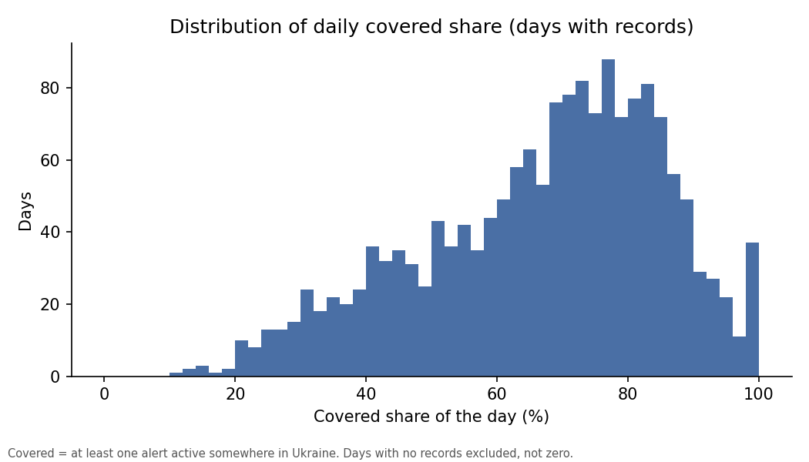
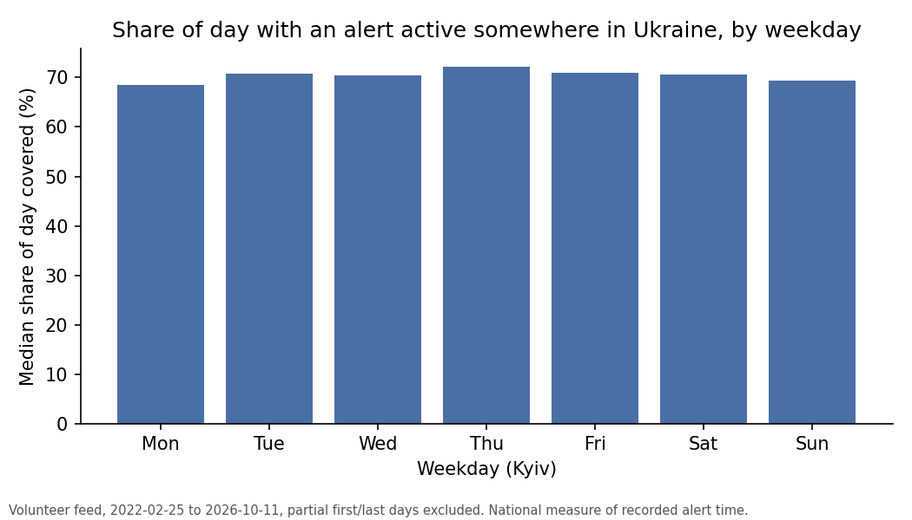

# Chapter 9: Daily and weekly alert coverage

*How much of each day and week had an alert active somewhere in Ukraine, and what that does and does not mean.*

Source: the volunteer alert record, 25 February 2022 to 11 October 2026. Reproduce everything with
`python -m scripts.chapter09_coverage`.

A **record** is one row: one alert in one oblast (a region). A minute is **covered** if at least one alert
was active somewhere in Ukraine during it, in any oblast. Alerts from all oblasts are merged, and alerts that
overlap or start the moment another ends are merged into one run. A **Kyiv calendar day** runs from
midnight to midnight in Kyiv time and has 1,440 minutes. The **covered share** of a day is the share of
that day's minutes with at least one recorded alert somewhere in Ukraine. The **median** is the middle
value: half the days are above it, half below.

**This is a national measure of recorded alert time. It is not the share of time any person, school,
business or route was affected.** An alert in one oblast covers the minute for the whole country, even if
nearly everyone in Ukraine was elsewhere. Nothing here measures effect on people.

---

## The short version

- **This is a national measure of recorded alert time, not of effect on people.** On a typical day, the
  national alert record shows an alert active somewhere in Ukraine for about 70% of the minutes (median
  70.2%). One day in ten is below 39.2%, and one in ten is above 88.1%.
- **Every one of the 1,688 days analysed has at least one minute with a recorded alert.** 80.2% of days are above 50%,
  and 38.8% are above 75%.
- **Weekday medians differ little** (68.6% to 72.3%, about 3.7 points); this was not tested.
- **The national coverage figure rose from 42.6% in 2022 to 85.2% in 2026.** Both years are partial, and
  the rise may reflect the volunteer record covering more over time, not only more alert time. This data
  cannot separate the two.
- **Dropping the inferred-end rows lowers the daily median by about 2 points** (to 68.1%). The overall
  picture is similar, but the figures do depend somewhat on these rows (section 6).

---

## 1. A typical day, nationally

| Measure (1,688 days) | Value |
|---|---:|
| Median covered share | 70.2% |
| 10th percentile | 39.2% |
| 90th percentile | 88.1% |
| Days above 25% | 98.2% |
| Days above 50% | 80.2% |
| Days above 75% | 38.8% |

The first day (25 February 2022) and the last (11 October 2026) are partial and are left out, so the days analysed run from 26 February 2022 to 10 October 2026. None of
the 1,688 days kept has zero covered minutes. The spread is wide: a day in the lowest tenth has under 40%
covered, and a day in the highest tenth has more than 88% covered. A high share means recorded alerts
were active somewhere in the country for much of the day. It does not say how many oblasts were
active at once. A low share in 2022 could also be a gap in the feed rather than a quiet day; Chapter 4
describes changes in what the record covers.

---

## 2. Weekdays and months

| Weekday | Median covered share |
|---|---:|
| Monday | 68.6% |
| Tuesday | 70.8% |
| Wednesday | 70.4% |
| Thursday | 72.3% |
| Friday | 71.0% |
| Saturday | 70.6% |
| Sunday | 69.4% |

The gap between the lowest and highest weekday is about 3.7 points. **This was not tested for
significance, and it is small** next to the day-to-day spread in section 1. No weekday pattern should be
read from it.

Pooling all years, the lowest month medians are April (65.1%), May (67.0%) and June (67.1%). The highest
are September (74.9%), August (72.3%) and March (72.1%). The years are not equally represented in each
month, and the yearly rise (section 3) mixes into these figures. No seasonal cause is claimed.

---

## 3. Change over the years

| Year | Median daily covered share |
|---|---:|
| 2022 (from 26 Feb, partial) | 42.6% |
| 2023 | 58.7% |
| 2024 | 72.4% |
| 2025 | 76.1% |
| 2026 (to 10 Oct, partial) | 85.2% |

The rise is large. **It may reflect how much of the alert activity the volunteer record captures over
time, not only more alert time**, and this data cannot separate the two. Chapter 4 and Chapter 6 describe
how the record changed. A reader who wants the real trend in alert time needs a source that did not change
how it recorded; this project does not have one.

---

## 4. Weeks with the highest national coverage

There are 240 full weeks (Monday to Sunday). The median week has 70.6% of its minutes covered, and the 90th
percentile is 85.0%.

*Table: the five weeks with the highest national covered share of recorded alert time. This is not a
measure of effect on people.*

| Week starting (Monday) | Covered share |
|---|---:|
| 14 September 2026 | 95.1% |
| 26 January 2026 | 94.9% |
| 24 August 2026 | 94.6% |
| 20 April 2026 | 93.7% |
| 3 August 2026 | 93.6% |

All five are in 2026. That matches the yearly rise in section 3 and is not a separate finding. After 7 September
the record is volunteer-only and has not been checked against the official record; the top week (14
September) falls after that date. These weeks are listed as descriptive statistics only. They do not say
where alerts were, what caused them, or how anyone was affected.

---

## 5. Episodes

An **episode** is one merged run of alert time (alerts from any oblast, touching intervals joined). The
median day has 10 episodes and the 90th percentile is 15. The median week has 68.

Episodes that cross midnight, or the Monday boundary for weeks, count on both sides. These are therefore
**pieces of runs, not unique alert events**, and they should not be read as a count of attacks or alarms.

---

## 6. Sensitivity

About 5% of the rows used (5,812 of 115,983, or 5.01%) have an end time that was guessed rather than recorded: the script
assumes 30 minutes. Dropping them gives:

| Measure | All rows | Without guessed end times |
|---|---:|---:|
| Daily median | 70.2% | 68.1% |
| Daily 90th percentile | 88.1% | 87.1% |
| Days above 50% | 80.2% | 77.4% |
| Weekly median | 70.6% | 67.8% |
| Days above 75% | 38.8% | 34.2% |

Dropping the inferred-end rows lowers the daily median by about 2 points, the share of days above 50% by
about 3, and the share of days above 75% by about 5 (38.8% to 34.2%). The overall picture is similar, but
the figures do depend somewhat on these rows. Dropping them also removes real alerts, so the lower figures
are not a more accurate picture.

---

## What this chapter cannot tell you

- **Effect on people.** The measure is national recorded alert time. It is not time lost, time in shelter,
  or anything a person, school, business or route experienced.
- **Cause.** Nothing here says what produced an alert or a busy week.
- **Threat type.** The record does not say what an alert was for.
- **Warning time.** There are no launch or impact times.
- **Completeness.** The volunteer record has no ground truth. Missing alerts would lower the shares.
- **The year trend.** The rise may be record coverage, alert time or both, and cannot be split here.
- **Weekday or season effects.** Neither was tested for significance.

This chapter is descriptive. It is not a warning, a forecast or a guide to action. For safety
instructions and live warnings, use official channels only (see `docs/SAFETY.md`).

---

## Method (technical appendix)

- **Data:** `volunteer_data_en.csv`, 115,989 rows; 6 rows with non-positive duration dropped, leaving
  115,983. Timestamps are UTC (world clock time) in the file and are converted to Kyiv time for days;
  UTC is used only inside the script.
- **Inferred ends:** 5,812 rows are marked `naive` in the file, meaning the end time was assumed (end = start + 30 minutes). They are kept in the main
  result and removed in the sensitivity run (110,171 rows used).
- **Covered minutes:** all oblasts are merged into one set of intervals, touching intervals joined; minutes
  are summed per Kyiv calendar day and per Monday-start week. Alerts crossing a boundary are split and count
  on both sides.
- **Days:** 1,690 calendar days have records; 25 February 2022 and 11 October 2026 are partial and
  excluded, leaving 1,688. Weeks: 242 have records and 240 are analysed.
- **Clock changes:** the two days a year with a clock change (23 or 25 hours) are measured against a
  fixed 1,440 minutes (10,080 for their weeks). The effect is negligible.
- **Checks:** no day exceeds 1,440 minutes and no week exceeds 10,080. A full recount of sampled
  days matched exactly.
- **What is counted:** the daily and weekly figures count only minutes where a recorded alert was active;
  minutes with no record are not counted as quiet.
- **Not done:** no significance test on weekdays, months or years.
- **Script:** `scripts/chapter09_coverage.py`; output in `output/analysis/chapter09_numbers.json`.
